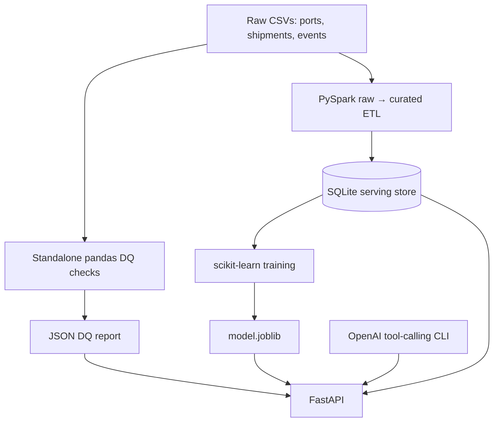

# Supply Chain Intelligence Mini-Platform

Python + PySpark take-home solution: data quality, curated shipping analytics, REST API, booking-time delay prediction, and an OpenAI tool-calling CLI.

**Status:** local Python/API tests passed in the authoring environment. The PySpark and Docker builds require Java/Spark/Docker and must be verified on your machine before submission. The packaged model and metrics were generated from an equivalent pandas/SQLite preparation path because PySpark could not be installed in the authoring environment. Running `docker compose up --build` regenerates all artifacts through the **actual PySpark pipeline**.

## Getting started

Requirements: Docker Engine + Docker Compose; for local development, Python 3.11 and Java 17.

```bash
docker compose up --build
```

The Docker build runs `python -m app.bootstrap`: standalone DQ profiling → PySpark ingestion → model training. API: http://localhost:8000 ; Swagger: http://localhost:8000/docs . On first build, downloading dependencies may take several minutes. Subsequent launches use the built image.

```bash
curl http://localhost:8000/health
curl 'http://localhost:8000/shipments?origin=CNSHA&page=1&page_size=5'
curl http://localhost:8000/shipments/SHP-00421
curl http://localhost:8000/routes/CNSHA/NLRTM/stats
curl http://localhost:8000/data-quality/report
curl -X POST http://localhost:8000/predict-delay -H 'Content-Type: application/json' -d '{"shipment_id":"SHP-00421"}'
```

Local execution (Java 17 required for Spark):

```bash
python3.11 -m venv .venv
source .venv/bin/activate   # Windows PowerShell: .venv\\Scripts\\Activate.ps1
pip install -r requirements.txt
python -m app.dq --input data --output artifacts/dq_report.json
python -m app.pipeline --input data --db artifacts/serving.db
python -m app.ml --db artifacts/serving.db --output artifacts/model.joblib
python -m uvicorn app.api:app --reload
python -m pytest -q
```

Optional GenAI assistant, from another terminal after API startup:

```bash
export OPENAI_API_KEY='your-key' # PowerShell: $env:OPENAI_API_KEY='your-key'
python -m app.assistant 'What is the delay risk for shipment SHP-00421?'
```

The LLM requires an API key and outbound internet; the rest of the service works without one. Never commit keys.

## Architecture diagram



**Data model:** `ports` (PK `port_code`), `shipments` (PK `shipment_id`, origin/destination foreign-key-like references to `ports`), `port_events` (PK `event_id`, `port_code` references `ports`). Events do **not** have a shipment identifier; they cannot be reliably joined to individual shipments. Route aggregates use shipments with known actual arrivals. Derived shipment fields: `actual_delay_hours`, `on_time_flag` (≤24 h), `route_key`, `transit_days_planned`, `transit_days_actual`. Spark deduplicates by shipment ID, rejects invalid port references and impossible chronology, then replaces SQLite serving tables on each run (idempotent at this scale). SQLite tables are read by FastAPI and the training script.

## Tech choices

| Component | Choice | Rationale |
|---|---|---|
| ETL | PySpark 3.5 | Demonstrates scalable distributed transformations on CSV inputs |
| DQ | pandas | Standalone, fast, reproducible, no Spark or database dependency |
| Serving | SQLite | Zero-ops and sufficient for ~5k shipments / ~25k events |
| API | FastAPI + Pydantic | Typed validation and autogenerated OpenAPI |
| ML | scikit-learn logistic regression | Transparent, fast baseline; no actual-time leakage |
| GenAI | OpenAI chat completions | Function/tool calling; configurable model |
| Testing | pytest, FastAPI TestClient, httpx | Unit, in-process integration and real socket HTTP coverage |
| CI | GitHub Actions | Lint, test, Docker build |

**100× volume:** move serving to PostgreSQL with indexes/partitioning, write curated Parquet/Delta in object storage, incremental Spark jobs, event-stream checkpoints, orchestrated retraining, and managed inference. SQLite is single-writer and whole-table replacements become expensive. We deliberately omitted Kubernetes, Terraform, a UI, Kafka, and a vector database to keep a focused thin slice.

## Data quality summary

Run `python -m app.dq --input data --output artifacts/dq_report.json` independently. The generated JSON contains all check names, row counts, percentages, severity, and recommended actions; checks can overlap. Counts below are from the supplied CSVs; use the JSON for the authoritative per-check figures.

| Issue | Rows affected | Handling |
|---|---:|---|
| Missing port country | 1 | Retain/flag; reference enrichment later |
| Missing shipment cargo type | 15 | Retain; impute in ML |
| Missing shipment weight | 73 | Retain; impute in ML |
| Missing shipment status | 54 | Retain/flag |
| Missing event type | 140 | Retain/flag |
| Missing event notes | 1,913 | Retain; optional |
| Missing actual departure / arrival | 349 each | Retain, label unavailable; exclude from supervised training |
| Duplicate IDs, invalid port references, invalid chronology, invalid quantities, negative event delays | See JSON | Deduplicate, quarantine critical rows, or flag |

**Important:** The PDF references twelve embedded problems but does not enumerate twelve individual issue definitions in its supplied text. This implementation checks the observable problems and additional invariants rather than claiming a known exact set of twelve. A separate JSON report lists every check, including zero-count checks.

## ML evaluation

The label is `actual_delay_hours > 24`. Training uses only booking-time fields: origin, destination, cargo type, container count, weight, planned transit duration, booking month, and static port congestion. Actual departure, actual arrival, status, and event observations are excluded from features. Missing numeric values are median-imputed, categoricals are imputed/one-hot encoded, and numeric features are standardized. A stratified 75/25 random split is used; the limitation is that temporal drift is not measured.

**Measured baseline on supplied data** (see `artifacts/metrics.json`):

| Metric | Value |
|---|---:|
| Holdout rows | 1,128 |
| Precision | 0.402 |
| Recall | 0.455 |
| F1 | 0.427 |
| ROC AUC | 0.506 |

This model is barely better than chance at ranking risk. Do **not** present it as production-quality; the dataset and feature set have weak predictive signal. For production: monitor input missingness and drift, calibration, precision/recall/F1/AUC on delayed labels, API latency and error rate; investigate material drift or sustained quality degradation and retrain only after evaluation against a time-based holdout.

The trained `artifacts/model.joblib` is included for reproducibility; Docker retrains at build time. Never load joblib files from untrusted sources.

## GenAI assistant

`app/assistant.py` exposes exactly three tool schemas: `query_shipments`, `get_route_stats`, `predict_delay`. The LLM chooses which to call. Calls go through the FastAPI endpoints, not raw SQL generated by the model. Guardrails: domain-restricted system prompt, tool allowlist, maximum four LLM rounds, and requirement to name tools behind factual claims. Structured logs include prompt/messages, tool names, tool responses, and final LLM response. **Production warning:** logs may contain user prompts and shipment/customer information; redact PII and restrict access/retention. Rough cost: for a small question using ~2k input and ~500 output tokens with a low-cost model, typically well below USD $0.01 per question; confirm current provider prices before claiming an exact amount.

## API and error handling

`GET /health`, `GET /shipments/{id}`, `GET /shipments`, `GET /routes/{origin}/{destination}/stats`, `POST /predict-delay`, `GET /data-quality/report`. Query parameters include `origin`, `destination`, `status`, `start_date`, `end_date`, `page`, `page_size`. Missing IDs/routes return 404, malformed input 422, missing store/model/report 503. Request logs include request ID, method, path, HTTP status and latency. Health reports readiness of required artifacts.

## CI/CD

`.github/workflows/ci.yml` installs Python and Java, installs dependencies, lints with Ruff, runs the bootstrap, executes the full test suite, and builds the Docker image. No green badge is claimed until this workflow actually runs successfully in your GitHub repository. Quality gate: require CI green and a reviewer before merging. Deployment strategy: tag immutable images, deploy to staging, smoke-test endpoints, then promote to production. Roll back by redeploying the previous immutable image and restoring a prior serving snapshot if needed.

## Production support runbook

1. **Post-deploy:** call `/health` (expect 200 and `status: ok`), then `/shipments`, `/data-quality/report`, and `/predict-delay`; inspect JSON request logs.
2. **Startup failure / 503:** check Docker logs, Java/PySpark bootstrap, `artifacts/serving.db`, `artifacts/model.joblib`, and `artifacts/dq_report.json`; rerun `python -m app.bootstrap` in a development environment.
3. **Incorrect route statistics:** inspect the DQ JSON, shipment timestamps, missing arrivals, deduplication and port-code validity; rerun DQ independently before rebuilding.
4. **Prediction errors:** confirm compatible scikit-learn version and model artifact, inspect invalid dates and unseen/missing input values.
5. **Rollback:** redeploy the previous image digest; restore the matching database/model snapshot. Future production additions: Prometheus/OpenTelemetry, alerts, managed secrets, audit logs, data lineage, backups, schema contracts, drift monitoring, and access control.

## Scaling to production

At millions of shipments, full Spark-to-pandas collection and SQLite writes are the first bottlenecks. Replace `toPandas()` with partitioned Parquet/Delta writes and batch database loading, use incremental CDC/event ingestion with watermarking and exactly-once/idempotent keys, and separate training from API deploys. For 24/7 reliability add horizontal API scaling, durable queues, retry/dead-letter handling, access control, backups, service-level objectives, observability, and versioned model promotion. Use point-in-time correct features and time-split evaluation.

## If I had more time

I would validate the full Docker build on a clean machine, add contract/property tests and a quarantine table with row-level reasons, implement true time-based model validation and probability calibration, add a route-ranking analytics tool, and make model training a separately versioned pipeline rather than a Docker build step.

## AI assistance disclosure

AI coding assistance was used to draft the scaffold, tests, data checks, documentation, and baseline approach. Engineering decisions and tradeoffs must be reviewed and owned by the submitting candidate; review the code, run the full stack, and be prepared to explain every part in the interview.

## Private GitHub submission

The assignment requests a **private repository**, not merely an emailed ZIP. Once reviewed and tested, from this folder:

```bash
git init
git add .
git commit -m "Build supply chain intelligence mini-platform"
gh auth login
gh repo create Nath724/supply-chain-intelligence --private --source=. --remote=origin --push
```

Use GitHub's private repository access settings to invite the hiring contact. Do not commit `.env` or API keys. Email the interviewer the private repository link once access is granted.

## Verification and performance smoke test

Run `python scripts/verify_submission.py` after initializing the serving database. This runs pytest and exercises five endpoints 30 times each, saving measured median and p95 response times to `artifacts/verification.json`. This is an **in-process smoke benchmark**, not a load test or throughput guarantee. The supplied verification report records that PySpark and Docker were not verified in the authoring environment; run `python -m app.bootstrap`, `pytest -q`, and `docker compose up --build` on a machine with the full dependencies before submission. The initial model ROC AUC near 0.5 indicates weak discrimination; do not represent this as a high-performing predictive model.
